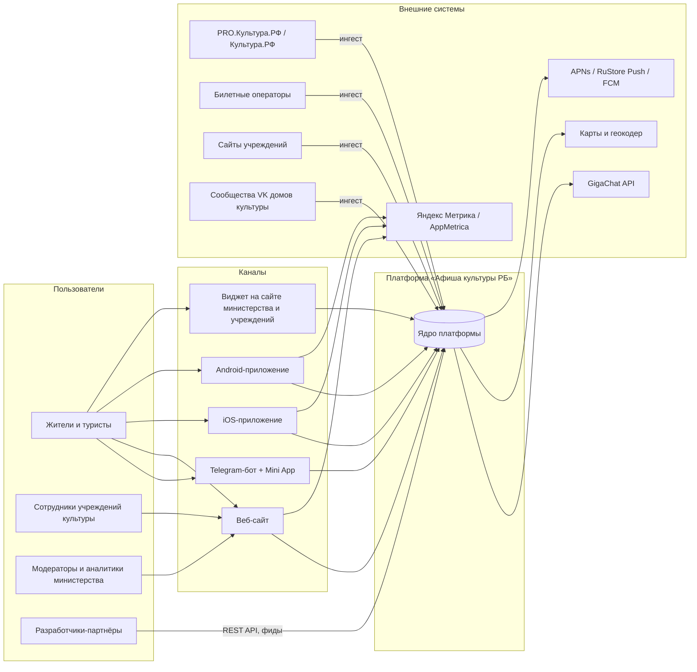
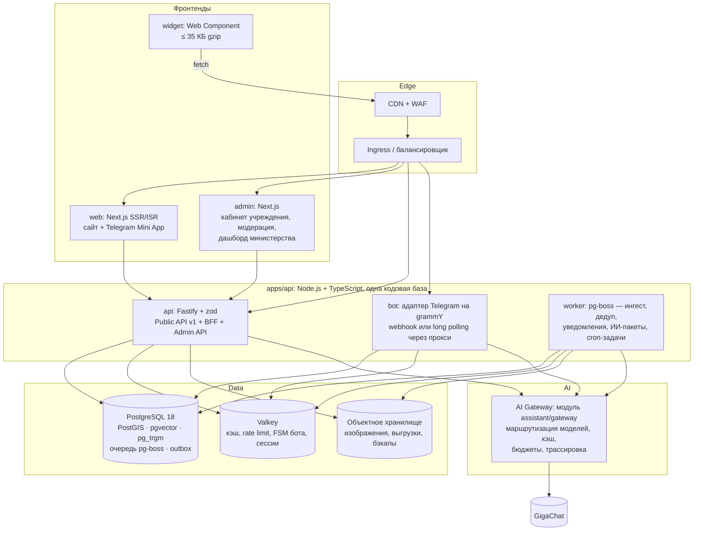
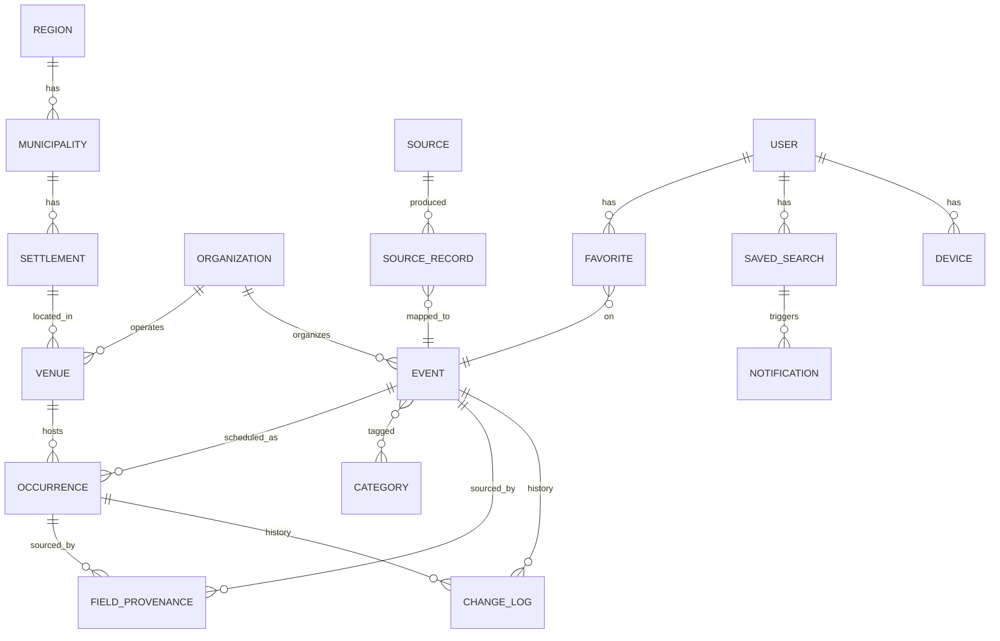
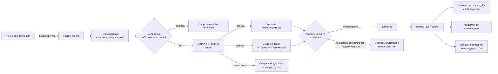
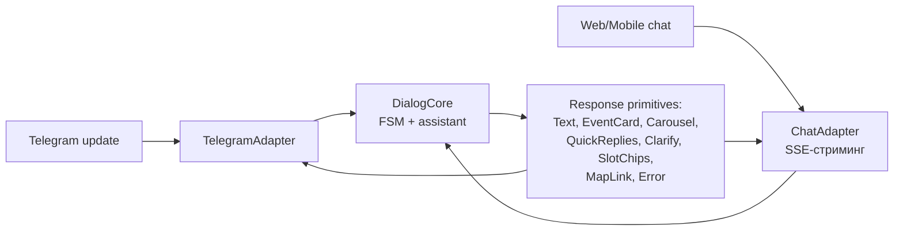

# 04. Архитектура

> Документ — источник истины для технических решений. Любое отклонение оформляется ADR (раздел 16) и проходит жюри `jury-architect`.

## 1. Архитектурные принципы

1. **Достоверность важнее полноты.** Ни один факт о событии не появляется в интерфейсе, если у него нет источника. Каждое поле хранит происхождение (provenance) и время проверки. ИИ не генерирует факты, только выбирает из найденного и объясняет.
2. **Скучные технологии, необычный продукт.** Минимум движущихся частей: PostgreSQL — это и хранилище, и полнотекстовый поиск, и векторный поиск, и гео, и очередь задач. Уникальность — в доменной модели, UX и работе с данными, а не в количестве сервисов.
3. **Модульный монолит.** Одно приложение на Node.js и TypeScript (`apps/api`) с жёсткими границами модулей и тремя точками входа: API, бот и воркер (он же планировщик). Тот же код, разные процессы. Микросервисы на старте — лишняя сложность для команды и для будущей аттестации.
4. **Contract-first.** Zod-схемы в `packages/contract` — единственный источник истины для API. Из них экспортируется OpenAPI 3.1, по которому генерируются клиенты Swift и Kotlin; сайт, виджет и админка используют те же схемы и типы напрямую. Клиенты руками не пишутся.
5. **ИИ ускоряет, но не держит систему.** При недоступности GigaChat продукт работает: поиск, фильтры, бот-меню, понимание простых запросов на правилах. Деградация видна пользователю честно.
6. **Каналы не влияют на ядро.** Ядро диалога работает с абстрактными примитивами («карточка», «быстрые ответы», «карусель», «уточнение»), а адаптеры переводят их в Telegram, веб-чат и мобильные приложения. Новый мессенджер, если понадобится, — одна новая реализация адаптера без изменений ядра.
7. **Готовность к тиражированию.** `region_id` в каждой доменной таблице, конфигурация региона (языки, часовой пояс, справочник муниципалитетов, брендинг) вынесена в данные. Ту же платформу можно развернуть для другого субъекта РФ без форка.
8. **Приватность по умолчанию.** Сервисом можно пользоваться без регистрации. Персональные данные собираются минимально, логи ИИ обезличиваются, сроки хранения ограничены.
9. **Без вмешательства в системы министерства.** Интеграция с сайтом министерства — только через встраиваемый виджет, iframe или публичный API. Мы ничего не ставим на их серверы и ничего не требуем от их CMS, кроме вставки сниппета.

## 2. Контекст системы (C4, уровень 1)



## 3. Контейнеры (C4, уровень 2)



**Почему так:**

| Решение | Альтернатива | Почему выбрано |
|---|---|---|
| PostgreSQL как основа (FTS + pg_trgm + pgvector + PostGIS + очередь) | OpenSearch + Kafka + отдельная векторная БД | Объём данных региона — десятки тысяч событий в год, это порядки ниже пределов Postgres. Один источник истины, транзакционная согласованность, один компонент для бэкапа и аттестации. OpenSearch можно добавить позже как индекс-реплику (ADR-007), если вырастет нагрузка. |
| TypeScript на бэкенде и во всех веб-частях: Node.js 24 LTS, Fastify 5, pnpm workspaces | Go | Один язык в API, боте, воркере, сайте, админке и виджете. Zod-схемы контракта общие для сервера и TS-клиентов, Swift и Kotlin получают клиентов из экспортированного OpenAPI. Нагрузку региона Node.js закрывает с запасом (ADR-014). |
| Valkey | Redis | Совместим с Redis, лицензия BSD (у Redis после 2024 года лицензия неоднозначная). |
| Очередь задач и планировщик на Postgres (pg-boss) | BullMQ на Valkey, RabbitMQ | Задачи ставятся в той же транзакции, что и данные (transactional outbox «бесплатно»). Cron-расписания живут в той же очереди, отдельный процесс-планировщик не нужен. Нагрузка — сотни задач в минуту, Postgres справится. |
| Next.js для сайта и Mini App | SPA | SSR/ISR нужен для SEO: «афиша Стерлитамака» должна находиться в Яндексе. JSON-LD `schema.org/Event` даёт расширенные сниппеты. Mini App — та же кодовая база с маршрутами `/tma`. |
| Web Component для виджета | iframe | Shadow DOM изолирует стили и не конфликтует с CMS министерства. Работает на любой платформе. Для сайтов со строгой CSP есть iframe-фоллбэк. |
| Нативные Swift/Kotlin | KMP, Flutter | Требование заказчика. Общий код не пишется руками, а генерируется: API-клиенты из OpenAPI (экспорт из zod-схем), дизайн-токены через Style Dictionary, строки ru/ba из единого источника. |

## 4. Модули бэкенда (границы ответственности)

Приложение `apps/api`: Node.js 24 LTS (разработка на 25), TypeScript strict, Fastify 5 + zod, Drizzle ORM + drizzle-kit, pg-boss. Каждый модуль — каталог `src/modules/<module>/` с публичным входом `index.ts` (сервис модуля и его типы). Модули общаются только через этот вход и доменные события через outbox. Импорт внутренних файлов чужого модуля запрещён и проверяется `dependency-cruiser`. Схема БД описана в Drizzle, миграции генерирует drizzle-kit; сложные запросы (поиск, гео, векторы, `search_doc`) пишутся сырым SQL через шаблон `sql` из drizzle с параметрами. Точки входа процессов — `src/main/api.ts`, `src/main/bot.ts`, `src/main/worker.ts`.

| Модуль | Ответственность | Ключевые сущности |
|---|---|---|
| `geo` | Справочник региона: муниципалитеты, населённые пункты с ru/ba названиями и синонимами, геокодинг, расстояния | Region, Municipality, Settlement |
| `catalog` | Каноническая модель: учреждения, площадки, события, сеансы, категории, теги. Золотая запись, provenance, журнал изменений | Organization, Venue, Event, Occurrence, FieldProvenance, ChangeLog |
| `ingestion` | Коннекторы к источникам, расписание, сырые записи, нормализация в промежуточную схему, здоровье источников | Source, SourceRun, SourceRecord |
| `dedup` | Поиск кандидатов в дубли, скоринг, кластеризация, слияние и разъединение, очередь ручной проверки | MatchCandidate, MatchDecision, Cluster |
| `lifecycle` | Машина статусов сеансов, свежесть данных, детектор исчезновений, автозавершение | — (работает над Occurrence) |
| `search` | Гибридный поиск (FTS + триграммы + векторы + фильтры + гео), ранжирование, диверсификация, объяснимые признаки | SearchQuery, SearchResult |
| `assistant` | ИИ-агент: понимание запроса, уточнения, подбор, объяснения, верификатор фактов (`assistant/verifier.ts`), AI Gateway (`assistant/gateway`, GigaChat), eval-хуки | Conversation, Turn, Slots, AssistantTrace |
| `channels` | Ядро диалога и адаптеры каналов (Telegram, веб-чат, мобильный чат), рендер примитивов | ChannelUser, Message |
| `accounts` | Опциональные аккаунты, вход через Telegram, VK ID, Яндекс ID и Apple, предпочтения, согласия | User, Identity, Consent, Preferences |
| `engagement` | Избранное, подписки на сохранённые поиски, напоминания, «культурный дневник», маршруты | Favorite, SavedSearch, Reminder, CheckIn, Plan |
| `notify` | Доставка уведомлений: push, Telegram, email. Расписания, тихие часы, лимиты, дедупликация уведомлений | Device, Notification, DeliveryAttempt |
| `organizer` | Кабинет учреждения: профиль, площадки, события, импорт из Excel, ИИ-помощник заполнения, статистика | OrganizerMember, Draft, ImportJob |
| `moderation` | Очереди модерации, жалобы пользователей, редакционные подборки, аудит действий | ModerationTask, Report, Collection, AuditLog |
| `analytics` | Обезличенные логи поиска и диалогов, агрегаты, «карта спроса», качество данных учреждений, выгрузки для министерства | SearchLog, DemandGap, QualityScore |
| `publicapi` | Публичный API v1, ключи, квоты, фиды (iCal, RSS, JSON-LD), открытые данные, вебхуки партнёров | ApiClient, WebhookSubscription |
| `media` | Загрузка, проверка лицензий, ресайз, WebP/AVIF, blurhash, CDN | Image, ImageVariant |

## 5. Модель данных

### 5.1. Ключевая идея: «Событие» отдельно от «Сеанса»

- **Event** — само мероприятие или произведение: спектакль «Салауат», выставка, фестиваль. Описание, жанр, возрастной ценз, изображения, организатор.
- **Occurrence** — конкретный сеанс: дата и время, площадка, статус, цена, ссылка на билеты. У спектакля в репертуаре десятки сеансов. У выставки один «сеанс-интервал» с датами начала и конца и расписанием работы.

Так решаются типичные проблемы агрегаторов: один спектакль не превращается в 20 «разных событий» в выдаче, а перенос одного показа не ломает остальные.

### 5.2. ER-диаграмма (упрощённо)



### 5.3. Основные таблицы (сокращённо)

```sql
-- Все доменные таблицы содержат: id uuid (v7), region_id, created_at, updated_at.

event (
  id, region_id, organization_id,
  title jsonb,              -- {"ru": "...", "ba": "..."}
  summary jsonb,            -- короткое описание, ≤ 300 символов
  description jsonb,        -- полный текст (санитизированный HTML-подмножество)
  category_codes text[],    -- theatre, music, museum, cinema, kids, folk, education, festival...
  tags text[],              -- «для детей», «под открытым небом», «на башкирском языке»...
  age_rating smallint,      -- 0, 6, 12, 16, 18 (436-ФЗ), NULL запрещён для публикации
  kids_age_min smallint, kids_age_max smallint, -- если явно детское
  is_free boolean, price_min numeric, price_max numeric, currency char(3) default 'RUB',
  pushkin_card boolean,
  accessibility jsonb,      -- {wheelchair, hearing_loop, sign_language, audio_description, ...}
  languages text[],         -- язык мероприятия: ru, ba, tt...
  duration_min int,
  images jsonb,             -- ссылки на media.image + лицензия
  moderation_status text,   -- draft | pending | published | rejected | hidden
  trust_level text,         -- official | partner | aggregated | extracted
  quality_score real,       -- полнота и качество карточки 0..1
  search_tsv tsvector,      -- генерируется: ru-конфиг + simple для ba
  embedding halfvec(2560),  -- эмбеддинг title+summary+tags, модель EmbeddingsGigaR (2560 изм.);
                            -- halfvec, т.к. HNSW по vector ограничен 2000 измерениями
  canonical_slug text
)

occurrence (
  id, region_id, event_id, venue_id,
  starts_at timestamptz, ends_at timestamptz, all_day boolean,
  schedule jsonb,           -- для выставок: часы работы по дням недели
  status text,              -- scheduled | rescheduled | postponed | cancelled | sold_out | ended
  rescheduled_to uuid,      -- ссылка на новый сеанс при переносе
  availability text,        -- unknown | available | few_left | sold_out
  price_min numeric, price_max numeric,  -- переопределяет event
  ticket_links jsonb,       -- [{provider, url, is_primary}]
  last_verified_at timestamptz,
  freshness text            -- fresh | aging | stale | vanished
)

field_provenance (
  entity_type, entity_id, field, source_record_id,
  value_hash, observed_at, is_winning boolean, rule text
)

change_log (                -- append-only; основа «истории изменений» и уведомлений
  id, entity_type, entity_id, field, old_value jsonb, new_value jsonb,
  source_id, actor_id, reason, created_at
)

source_record (
  id, source_id, external_id, payload jsonb, payload_hash,
  fetched_at, parse_status, parse_errors jsonb, mapped_event_id, mapped_occurrence_id
)
```

**Часовой пояс.** Башкортостан живёт по `Asia/Yekaterinburg` (UTC+5). В БД всё хранится в `timestamptz`, а «сегодня», «в субботу» и «вечером» считаются в часовом поясе региона, не сервера и не клиента. Это частый источник багов, поэтому под него есть отдельные тесты.

### 5.4. Индексы и производительность

- `occurrence (region_id, starts_at) WHERE status NOT IN ('ended')` — основной фильтр по дате.
- GIST по `venue.geo` (PostGIS geography) — «рядом со мной» и радиус.
- GIN по `event.search_tsv`, GIN `gin_trgm_ops` по нормализованному заголовку — опечатки и частичные совпадения.
- HNSW (`halfvec_cosine_ops`) по `event.embedding` — семантический поиск. Смена модели эмбеддингов = новая колонка + фоновый пересчёт (эмбеддинги 14 ₽ за 1 млн токенов, весь каталог — копейки).
- Материализованное представление `search_doc` (event × ближайшие сеансы × площадка × муниципалитет), обновляется инкрементально по outbox. Поиск идёт по нему без JOIN на горячем пути.

## 6. Поток данных



Детали источников, правил выживания полей, алгоритма дедупликации и машины статусов — в [06-data.md](06-data.md).

## 7. Поиск и ранжирование

**Шаг 1. Жёсткие фильтры (SQL):** регион, интервал дат (в TZ региона), муниципалитет или радиус, `moderation_status = published`, статус сеанса не `cancelled` и не `ended` (если пользователь не попросил иное), возраст, бюджет, категория, бесплатно, Пушкинская карта, доступность.

**Шаг 2. Кандидаты (union, до 200):**
- лексика: `ts_rank_cd` по `search_tsv` и `similarity()` по триграммам;
- семантика: косинусная близость эмбеддинга запроса к `event.embedding` (только при свободном тексте);
- без текста — все отфильтрованные.

**Шаг 3. Скоринг (объяснимая линейная модель, веса в конфиге):**

```
score = w_text·text + w_sem·semantic + w_time·time_fit + w_dist·distance_decay
      + w_qual·quality_score + w_pop·popularity_7d + w_trust·trust
      + w_pers·personal_fit (только если персонализация включена)
```

Каждый компонент сохраняется в `explain` и используется для чипов «почему это здесь» в интерфейсе. Это заодно закрывает требование закона о рекомендательных технологиях: правила ранжирования публикуются, персонализацию можно выключить.

**Шаг 4. Диверсификация (MMR):** не больше двух сеансов одного события и трёх событий одной площадки в первой десятке.

**Шаг 5. Группировка:** сеансы одного события сворачиваются в одну карточку с «ещё 5 дат».

**Бюджет производительности:** p95 ≤ 120 мс для поиска без семантики и ≤ 250 мс с семантикой (эмбеддинг запроса кэшируется).

## 8. API

### 8.1. Поверхности

| Поверхность | Префикс | Аутентификация | Назначение |
|---|---|---|---|
| Public API v1 | `/v1/*` | без ключа (60 rpm/IP) или с API-ключом (600 rpm) | Открытые данные: события, сеансы, площадки, учреждения, муниципалитеты, категории, поиск, фиды |
| BFF | `/app/*` | JWT устройства или пользователя | Персонализация, избранное, подписки, ассистент, push-токены |
| Admin API | `/admin/*` | сессия + 2FA, RBAC | Кабинет учреждения, модерация, дашборд министерства |
| Webhooks (out) | — | HMAC-подпись | Партнёрам: `occurrence.changed`, `event.published`, `occurrence.cancelled` |
| Feeds | `/feeds/*` | без ключа | iCal (по учреждению, площадке, сохранённому поиску), RSS, JSON-LD |

### 8.2. Соглашения

- Контракт — zod-схемы в `packages/contract`. Изменения в API начинаются с них. Fastify валидирует запросы и ответы теми же схемами, а TS-клиенты (сайт, виджет, админка) импортируют их напрямую. Из схем экспортируется OpenAPI 3.1 (`packages/contract/openapi.json`) — для клиентов Swift и Kotlin и для документации. CI проверяет, что закоммиченный `openapi.json` совпадает со свежим экспортом (нет дрейфа), а запущенное API — со спецификацией (schemathesis в docker).
- Курсорная пагинация (`?cursor=…&limit=…`), `ETag` и `If-None-Match`, `Cache-Control` для CDN.
- Язык: `?lang=ru|ba` или `Accept-Language`. Если перевода нет, отдаётся оригинал с полем `lang_fallback: true`.
- Ошибки: RFC 9457 (`application/problem+json`).
- Деньги — строки-десятичные (`"500.00"`), даты — RFC 3339 с офсетом `+05:00`.
- Версионирование в пути. Ломающие изменения — только в `/v2`, старая версия живёт не меньше 12 месяцев.
- Документация: Scalar или Redoc по адресу `/docs/api` + страница «Быстрый старт» с примерами на curl, JavaScript/TypeScript и PHP (для 1С-Битрикс).
- Лицензия данных — уточнить с министерством (предложение: CC BY 4.0 для текстов и метаданных, изображения — по лицензии правообладателя, поле `license` в ответе).

### 8.3. Пример

```http
GET /v1/occurrences?municipality=ufa&date_from=2026-11-07&date_to=2026-11-08&age_max=6&price_max=1000&category=kids&lang=ru
```

```json
{
  "items": [{
    "id": "01J...",
    "event": {"id": "01J...", "title": "Буратино", "age_rating": 0, "categories": ["theatre","kids"], "pushkin_card": false},
    "venue": {"id": "01J...", "name": "Башкирский государственный театр кукол", "geo": [54.73, 55.96]},
    "starts_at": "2026-11-07T11:00:00+05:00",
    "status": "scheduled",
    "availability": "few_left",
    "price": {"min": "400.00", "max": "700.00", "currency": "RUB"},
    "ticket_links": [{"provider": "theatre_box_office", "url": "https://..."}],
    "provenance": {"trust_level": "official", "last_verified_at": "2026-11-02T14:05:00+05:00", "sources": ["pro_culture"]}
  }],
  "next_cursor": "eyJ...",
  "explain_available": true
}
```

## 9. Каналы: ядро диалога



**Стратегия каналов (с учётом реальности осени 2026):**

| Канал | Роль | Ключевые ограничения |
|---|---|---|
| **Telegram-бот + Mini App** | Требование ТЗ; единственный мессенджер-канал: бот, Mini App, inline-режим, группы, уведомления об отменах и переносах | С весны 2026 Telegram в РФ заблокирован, запросы к `api.telegram.org` из российских ЦОД зависают. Решение — исходящий HTTPS-прокси за рубежом **только для вызовов Bot API** (long polling через прокси). Данные пользователей хранятся в РФ. 41-ФЗ запрещает госорганам и подведомственным организациям информировать граждан через иностранные мессенджеры. Рекомендация министерству: оператор бота — не госорган и не подведомственное учреждение (подрядчик или партнёр) **или** бот без персональных рассылок; решение за юристами министерства (09). |
| **Веб + PWA** | Основной канал, SEO, документация, кабинеты | При отключениях мобильного интернета не откроется, если домен не в региональном белом списке (заявка — задача владельца). |
| **iOS / Android** | Самый богатый опыт, офлайн-кэш | Офлайн-кэш избранного и ближайших событий своего района — работает и при отключениях. |
| **Виджет** | Сайт министерства (1С-Битрикс), сайты учреждений, районных газет и муниципалитетов | — |
| **VK / OK министерства** | Автопостинг подборок (госпаблики обязательны по 270-ФЗ) | Публикация с модерацией редактора, без персональных данных. |

- Каждый адаптер объявляет **capabilities** (inline-кнопки, карусели, редактирование сообщений, Markdown, Mini App, длина сообщения). Ядро выбирает лучшее представление: в Telegram карусель становится серией карточек с пагинацией через `editMessage`, в вебе — горизонтальным скроллом.
- Состояние диалога (слоты, контекст) хранится в Valkey (TTL 24 ч) и снапшотится в Postgres для аналитики в обезличенном виде.
- Бот на grammY: webhook-режим или long polling через исходящий прокси (по доступности Bot API), идемпотентность по `update_id`, ответ в течение 1 с, тяжёлая работа — в фоне (задача pg-boss) с индикатором «печатает…».
- Рассылки идут через очередь с token bucket: глобальный лимит Telegram (около 30 сообщений в секунду) и не больше 1 сообщения в секунду на чат.

## 10. Нефункциональные требования (SLO)

| Метрика | Цель |
|---|---|
| Доступность Public API и сайта | 99,9 % в месяц |
| p95 API (без ИИ) | ≤ 300 мс |
| Первый ответ бота (не ИИ) | ≤ 1,5 с |
| ИИ: первые карточки / полный ответ | ≤ 3 с / ≤ 7 с (p95) |
| Свежесть: события из официальных источников | 95 % изменений видны ≤ 60 мин |
| Отмена или перенос → уведомление подписчикам | ≤ 15 мин после фиксации изменения |
| Web Vitals (мобильный 4G, средний Android) | LCP ≤ 2,5 с, INP ≤ 200 мс, CLS ≤ 0,1 |
| Виджет | ≤ 35 КБ gzip, ≤ 1 запрос к API на рендер, без cookies |
| RPO / RTO | 15 мин / 4 ч |

## 11. Инфраструктура и деплой

- **Облако:** российское, с соответствием 152-ФЗ (сравнение и цены — в [09-compliance-security.md](09-compliance-security.md) и [10-finance.md](10-finance.md)). Предпочтение — провайдер с аттестованным сегментом, если система станет ГИС.
- **Рантайм:** управляемый Kubernetes (2–3 узла), Helm-чарты, деплой через GitOps (Argo CD). Альтернатива для пилота — Docker Compose на двух ВМ с тем же набором образов.
- **Данные:** управляемый PostgreSQL (HA, PITR), управляемый Valkey/Redis, S3-совместимое хранилище, CDN.
- **IaC:** Terraform (провайдеры облаков РФ), всё окружение воспроизводимо.
- **Окружения:** `dev` (эфемерные стенды на PR), `staging` (копия прода с обезличенными данными), `prod`.
- **CI/CD:** GitLab CI (self-hosted или GitFlic/GitVerse — уточнить с министерством) или GitHub Actions на время разработки. Пайплайн: линт (Biome) → типы (`tsc --noEmit`) → границы модулей (dependency-cruiser) → юнит (vitest) → интеграция (vitest + PostgreSQL из docker-compose) → контракт (дрейф `openapi.json` + schemathesis) → e2e (Playwright) → ИИ-eval → сборка образов → подпись (cosign) → сканирование (trivy) → деплой.
- **Мобильная сборка:** Xcode Cloud или fastlane на собственном macOS-раннере; Gradle + fastlane для Android; публикация в RuStore, App Store, Google Play и AppGallery (ограничения — в 09).

## 12. Наблюдаемость

- OpenTelemetry для Node.js во всех процессах (api, bot, worker): трейсы и метрики; логи — pino (JSON) с `trace_id`.
- Prometheus + Grafana (дашборды: API, бот, ингест, ИИ, уведомления), Loki для логов, Tempo для трейсов.
- Ошибки: GlitchTip (MIT, совместим с Sentry SDK) — на сервере и в мобильных приложениях.
- **ИИ-трассировка:** каждый ход ассистента сохраняет промпт-версию, модель, токены, латентность, слоты, ID кандидатов и решение верификатора (без ПДн). Это нужно для разбора жалоб и для eval.
- Алерты: падение источника, рост доли «ничего не найдено», доля отказов верификатора ИИ > 2 %, расход токенов > дневного бюджета, отставание очереди уведомлений.

## 13. Режимы деградации

| Отказ | Поведение |
|---|---|
| GigaChat недоступен или превышен бюджет | Ассистент переходит на парсер-на-правилах (даты, цены, возраст, города, категории) + шаблонные объяснения. Баннер: «Умный подбор временно упрощён». Поиск и фильтры работают полностью. |
| Источник данных недоступен | Данные источника не удаляются. `freshness` стареет, после 72 ч карточка помечается «давно не обновлялось», а события без подтверждения понижаются в выдаче ИИ. |
| Telegram заблокирован (текущее состояние) | Bot API — через исходящий прокси. Те же функции доступны на сайте и в приложениях. |
| Отключение мобильного интернета в районе (белые списки) | Работают офлайн-кэш нативных приложений (избранное + ближайшие события своего района на 7 дней, пометка «данные на 14:05») и уже загруженные данные. Telegram-бот недоступен; сайт недоступен, пока домен не включён в региональный белый список. |
| Push недоступен | Уведомления дублируются в бот (если пользователь связал аккаунт) и в inbox приложения. |
| БД read-only (обслуживание) | Публичная часть работает из CDN-кэша и read-реплики, запись ставится в очередь. |

## 14. Тиражирование на другие регионы

- `region` — отдельная сущность с конфигурацией: языки (`ru`, `ba`), часовой пояс, справочник муниципалитетов, брендинг (токены дизайна), список источников, контакты министерства.
- Row-level security в Postgres по `region_id` для админки. Публичное API скоупится поддоменом или параметром.
- Сценарий питча: «через 2 недели после запуска в РБ — пилот в соседнем регионе без форка кода».

## 15. Структура репозитория (монорепозиторий)

Монорепозиторий на pnpm workspaces: все TypeScript-части (`apps/api`, `apps/web`, `apps/admin`, `apps/widget`, `packages/*`) — рабочие пространства pnpm. iOS и Android собираются своими инструментами (Xcode, Gradle).

```
/apps
  /api                Node.js + TypeScript: модульный монолит (Fastify, grammY, pg-boss, Drizzle)
    /src/modules/{geo,catalog,ingestion,dedup,lifecycle,search,assistant,channels,
                  accounts,engagement,notify,organizer,moderation,analytics,publicapi,media}
    /src/main/{api,bot,worker}.ts   точки входа процессов
    /drizzle          миграции drizzle-kit (SQL)
    /test             vitest: юнит, интеграция (база afisha_test), фикстуры
  /web                Next.js: публичный сайт + Telegram Mini App (/tma)
  /admin              Next.js: кабинет учреждения, модерация, дашборд «Пульс культуры»
  /widget             Web Component + конструктор виджета
  /ios                Xcode-проект (SwiftUI)
  /android            Gradle-проект (Jetpack Compose)
/packages
  /contract           zod-схемы API → openapi.json (OpenAPI 3.1) → генерация клиентов Swift и Kotlin
  /design-tokens      токены (JSON, W3C DTCG) → CSS / Swift / Kotlin через Style Dictionary
  /i18n               строки ru/ba (ICU MessageFormat) → JSON / .xcstrings / strings.xml
/eval                 эталонные наборы и раннер для ИИ-агента
/infra                terraform, helm, docker, docker-compose для локальной разработки
/docs                 этот план
/jury                 рубрики и отчёты жюри
/.claude/agents       определения агентов-жюри
```

## 16. Реестр архитектурных решений (ADR)

Полные ADR лежат в `docs/adr/NNNN-*.md` (создаются по мере работы). Стартовый набор:

| № | Решение | Статус |
|---|---|---|
| 001 | Модульный монолит на Node.js/TypeScript (Fastify) с точками входа api/bot/worker | принято |
| 002 | PostgreSQL как единое хранилище: FTS, pg_trgm, pgvector, PostGIS, очередь задач | принято |
| 003 | Разделение Event и Occurrence, статусы на уровне сеанса | принято |
| 004 | Provenance на уровне поля и append-only журнал изменений | принято |
| 005 | Contract-first через zod-схемы в `packages/contract` → OpenAPI 3.1 → генерация клиентов Swift/Kotlin; TS-клиенты используют схемы напрямую | принято |
| 006 | ИИ не генерирует факты: выбор только из кандидатов + верификатор объяснений | принято |
| 007 | OpenSearch откладывается; триггер — p95 поиска > 300 мс или > 500 тыс. сеансов | отложено |
| 008 | Нативные приложения без KMP; общее — через кодогенерацию, токены и строки | принято |
| 009 | Ядро диалога независимо от канала; адаптеры Telegram и веб/мобильного чата | принято |
| 010 | `region_id` во всех доменных таблицах (готовность к тиражированию) | принято |
| 011 | Valkey вместо Redis (лицензия) | принято |
| 012 | Виджет — Web Component с Shadow DOM, iframe как фоллбэк | принято |
| 013 | Персонализация отключаема, правила ранжирования публичны (закон о рекомендательных технологиях) | принято |
| 014 | Единый язык TypeScript для бэкенда и веба (решение владельца 02.11.2026; Go рассматривался — отклонён ради общих схем контракта и одного языка во всех веб-частях) | принято |
| 015 | Журнал `change_log` — outbox уведомлений (SKIP LOCKED в процессе бота); pg-boss — расписания воркера | принято |
| 016 | PostgreSQL 18 (встроенный `uuidv7()`) | принято |

## 17. Технологический стек

| Слой | Технологии | Лицензия |
|---|---|---|
| Backend | Node.js 24 LTS (разработка на 25), TypeScript strict, pnpm workspaces, Fastify 5, zod, Drizzle ORM + drizzle-kit, pg-boss, undici, pino | MIT / Apache 2.0 |
| Бот | grammY (Telegram), webhook или long polling через исходящий прокси | MIT |
| ИИ | собственный тонкий клиент GigaChat на undici/fetch для API Сбера (OAuth, chat completions с function calling, эмбеддинги, корень НУЦ через кастомный CA) + npm-пакет `openai` для OpenAI-совместимого API GigaChat на cloud.ru; собственный AI Gateway — модуль `assistant/gateway` (провайдеры, кэш, бюджеты, семафор); LangChain в рантайме не используется, чтобы промпты и вызовы были под полным контролем | MIT / Apache 2.0 |
| Обработка текста | sanitize-html (санитизация по allow-list), fuzzball (`token_set_ratio` для дедупликации) | MIT |
| БД | PostgreSQL 18 (нужен для встроенного uuidv7()), PostGIS, pgvector (halfvec), pg_trgm, unaccent | PostgreSQL / GPL (PostGIS как расширение) |
| Кэш | Valkey 8 | BSD |
| Веб | Next.js (App Router), React, TypeScript, zod-схемы из `packages/contract`, CSS Modules + токены, Radix Primitives, TanStack Query | MIT |
| Карты (веб) | MapLibre GL JS + векторные тайлы (собственные или провайдер РФ) либо Яндекс Карты JS API v3 — выбор в 06/10 | BSD / коммерческая |
| Виджет | Lit или чистый Custom Elements + Vite | BSD / MIT |
| iOS | Swift 6, SwiftUI, Observation, swift-openapi-generator, GRDB, WidgetKit, ActivityKit, App Intents | Apache 2.0 / MIT |
| Android | Kotlin 2.x, Jetpack Compose, Material 3, Hilt, Coroutines/Flow, Ktor client или Retrofit, Room, Glance, WorkManager | Apache 2.0 |
| Качество кода | Biome (линт и формат), `tsc --noEmit` (strict), dependency-cruiser (границы модулей) | MIT / Apache 2.0 |
| Тесты | vitest (юнит и интеграция на реальной PostgreSQL из docker-compose, база `afisha_test`), schemathesis (внешний инструмент, запуск в docker), Playwright, axe-core, Lighthouse CI, k6, XCTest + swift-snapshot-testing, Compose UI Test + Roborazzi, Maestro | MIT / Apache |
| Наблюдаемость | OpenTelemetry (Node.js), pino, Prometheus, Grafana, Loki, Tempo, GlitchTip | Apache / AGPL (self-host) / MIT |
| Инфраструктура | Terraform/OpenTofu, Helm, Argo CD, cosign, trivy | MPL / Apache |
