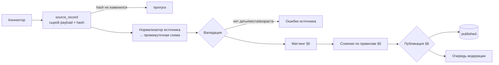
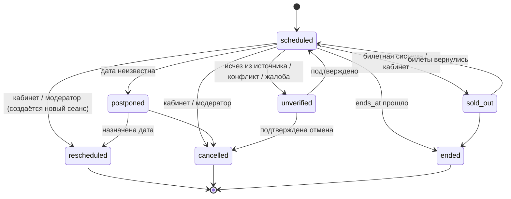

# 06. Данные: источники, нормализация, дедупликация, статусы

> «Выдуманных мероприятий нет» — прежде всего свойство данных, а уже потом свойство ИИ. Этот документ описывает, откуда берутся события, как они сводятся в одну достоверную запись и как мы узнаём об отменах и переносах.
> Факты об источниках проверены 02.11.2026; ссылки собраны в конце.

## 1. Принципы

1. **У каждого поля есть источник и время подтверждения** (`field_provenance`). Без источника поле не показывается.
2. **Уровень доверия определяет путь к публикации.** Официальные источники публикуются автоматически, извлечённые ИИ — только после модерации.
3. **Статусы — главная боль отрасли.** Федеральный источник их не передаёт (см. §2.1), поэтому статусы собираются из нескольких сигналов, и у министерства есть рычаг — обязать учреждения отмечать отмены.
4. **Законно и этично.** Используем API и договоры, а не скрапинг вопреки правилам площадок. Изображения — только с понятной лицензией.

## 2. Источники

| Пр. | Источник | Что даёт | Доступ | Частота | Доверие |
|---|---|---|---|---|---|
| 1 | **API PRO.Культура.РФ** (АИС ЕИПСК) | События и сеансы, места, организации, цены, возраст, Пушкинская карта, доступная среда, координаты, ссылки на покупку | Партнёрский ключ: письмо на partners@team.culture.ru (лучше от министерства) | Инкрементально по `updateDate`, каждые 10–15 мин (если позволят лимиты) | official |
| 1 | **Кабинет учреждения** (наш) | Всё, включая **статусы** (перенос, отмена, распродано) | Приглашение от министерства | Мгновенно | official+ (приоритет по статусам) |
| 2 | **opendata.mkrf.ru** — набор «Мероприятия в сфере культуры» (7705851331-events) | Полный срез событий, JSON/XML, структура v3 (24.06.2026) | Открыто + бесплатный ключ к REST | Раз в неделю: сверка полноты | official |
| 2 | **kulturarb.ru** «Культурный мир Башкортостана» (портал при Минкультуры и Башфилармонии) | Репертуарные планы крупных учреждений | RSS (согласование через министерство не должно быть проблемой) | Раз в сутки | official (после матчинга; «месячные планы» без сеансов — в модерацию) |
| 2 | **Импорт Excel** | Планы мероприятий учреждений и районных отделов культуры | Кабинет / модератор | По мере поступления | official |
| 3 | **Билетные системы**: QuickTickets (через неё продают Башгосфилармония, Башдрамтеатр им. Гафури, театр «Нур», ансамбль им. Гаскарова, Дворец молодёжи, ГКДЦ), Radario (API v1.1), Яндекс Афиша (API по договору, статус инфопартнёра), Kassir.ru (партнёрские ссылки) | Цены, наличие мест, «распродано», ссылки на покупку | Договоры и ключи | 15–60 мин | partner |
| 4 | **Сайты учреждений** | Репертуар учреждений, которых нет в PRO.Культура | Только с письменного согласия учреждения (через министерство) | Раз в сутки | aggregated |
| 5 | **Сообщества VK** домов культуры и библиотек | Анонсы сельских событий, сигналы отмены и переноса | VK API с верифицированным бизнес-профилем | Каждые 2–6 ч | extracted (только через модерацию) |
| 5 | **Жалобы пользователей** | «Событие отменили», «не та цена» | Кнопка на карточке | — | signal |

### 2.1. API PRO.Культура: что важно знать

- Версия публичной документации — 2.5 (PDF от 20.05.2022). Ключ `apiKey` выдаётся при партнёрстве и отзывается при его прекращении (ответ 403).
- Методы: `/api/2.5/pushkinsCardEvents`, `/places`, `/organizations`, `/categories`, `/locales`. Регион со всеми районами выбирается через `subordinations` (рекурсивно) или `strictSubordinations`. Пагинация — `limit` ≤ 100 и `offset`. Есть фильтры `status=accepted`, `start`/`end`, `isPushkinsCard`, `free`, категории.
- **Общий метод `/events` для всех событий, а не только Пушкинских, в документации 2.5 не описан.** Это нужно уточнить у partners@ при получении ключа. Запасной план — набор opendata (раз в неделю) + кабинет учреждения + билетные системы.
- Поля события: `seances` (start/end, `startLocal`), `price`, `maxPrice`, `isFree`, `ageRestriction`, `isPushkinsCard`/`statusPushka`, `isAccessible` и коды доступной среды (a1–a16, b1–b14, c1–c9, d1–d2, e1), `mapPosition`, адрес с кодами ФИАС, `saleLink`, `additionalSaleLinks`, `ticketSystems`, `updateDate`, `organization`.
- **Статусов «отменено», «перенесено», «распродано» в API нет** — только статус модерации (`accepted`, `new`, `rejected`).
- У изображений есть `author` и `source`, **поля лицензии нет**. Права нужно урегулировать с министерством (§10).
- Лимиты частоты запросов не опубликованы. Начинаем консервативно: 2 запроса в секунду с экспоненциальной задержкой.

### 2.2. VK: ограничения

- С 07.09.2026 без верификации бизнес-профиля — 10 000 вызовов API в месяц, после верификации — до 100 млн. Верификацию нужно пройти.
- Правила платформы (ред. 19.08.2026): данные `wall.get` нельзя использовать для аналитики и передавать третьим лицам без согласия VK (п. 2.4); на чужой контент, включая картинки, нужно согласие правообладателя (п. 3.1).
- Поэтому VK используется **только как сигнал для модератора**: из поста извлекается черновик события, модератор или учреждение его подтверждает, картинка из поста не публикуется без согласия.

## 3. Конвейер: от сырой записи до публикации

**Промежуточная схема** (единая для всех коннекторов): `external_id`, `title`, `description`, `category_hint`, `age_rating`, `price_min`, `price_max`, `is_free`, `pushkin_card`, `accessibility_codes`, `sessions[] {starts_at, ends_at, venue_ref, status_hint, availability_hint, ticket_url}`, `venue_ref {external_id, name, address, fias, lat, lon}`, `organization_ref {external_id, name, inn}`, `images[] {url, author, source, license}`, `source_updated_at`, `confidence` (для extracted).

## 4. Нормализация

| Поле | Правило |
|---|---|
| Время | В PRO.Культура есть UTC (мс) и `startLocal`: проверяем согласованность, хранение — `timestamptz`. У источников без часового пояса считаем время в `Asia/Yekaterinburg` и помечаем `tz_assumed`. |
| Возраст | Только значения 436-ФЗ: 0, 6, 12, 16, 18. Без возрастного знака событие не публикуется — уходит в очередь с запросом к учреждению. |
| Цена | «от 300 до 1500», «300–1500 ₽», «бесплатно / вход свободный», «по Пушкинской карте» → `price_min`, `price_max`, `is_free`, `pushkin_card`. «Цена уточняется» → `NULL` + флаг. |
| Категории | Таблица соответствий категорий PRO.Культура → наши 7 категорий + теги (в `ingestion/mappings/pro_culture_categories.yaml`). Неоднозначное доклассифицирует GigaChat Lite с пометкой `inferred`. |
| Место | Координаты источника → PostGIS. Муниципалитет определяется по точке в полигоне (границы муниципалитетов РБ из OSM), сверяется с ФИАС и `subordinations` PRO.Культура. |
| Площадка | Матчинг площадок отдельно от событий: расстояние ≤ 150 м + похожесть названия; справочник алиасов («ГКЗ Башкортостан» = «Государственный концертный зал “Башкортостан”»). |
| Текст | Санитизация HTML по allow-list (sanitize-html), удаление трекинговых параметров из ссылок, нормализация кавычек и пробелов, `ё → е` только в поисковом индексе. |

## 5. Дедупликация

Типичные дубли: один спектакль в PRO.Культура, на сайте театра, в QuickTickets и в посте VK; выставка, которую каждый источник называет по-своему; один концерт на двух площадках-алиасах.

### 5.1. Уровни матчинга

1. **Идентичность источника:** тот же `source_id` + `external_id` → обновление записи.
2. **Сильные ключи:** совпадение `saleLink` (нормализованного), ID PRO.Культура в данных билетной системы, ссылка на событие в посте.
3. **Блокировка кандидатов:** тот же муниципалитет **и** время начала в пределах ±45 мин (для выставок — пересечение интервалов) **и** (та же площадка **или** расстояние ≤ 300 м).
4. **Скоринг пары** (признаки):
   - похожесть нормализованных названий: триграммы (pg_trgm) + token-set ratio (fuzzball, `token_set_ratio`). Нормализация убирает кавычки, возрастные знаки и служебные слова («спектакль», «концерт», «премьера»);
   - косинусная близость эмбеддингов (название + краткое описание);
   - разница времени начала, совпадение площадки, совпадение организатора, пересечение цен, совпадение возраста.
   
   Модель — логистическая регрессия (объяснимая) на размеченных парах. Стартовая разметка — 500 пар, дальше пополняется решениями модераторов.
5. **Решение:** ≥ 0,92 — автослияние; 0,70–0,92 — очередь модерации (бок о бок); < 0,70 — разные события.
6. **Кластеризация:** union-find с запретом объединять два сеанса одного источника с разными `external_id` и разным временем (защита от цепных ложных слияний).

### 5.2. Цели качества

| Метрика | Порог |
|---|---|
| Precision автослияния | ≥ 0,99 (ложное слияние прячет событие — худшая ошибка) |
| Recall (с учётом очереди модерации) | ≥ 0,95 |
| Доля пар в очереди | ≤ 10 % кандидатов |

### 5.3. Разъединение

Модератор может разъединить кластер. Решение запоминается как «никогда не сливать эти записи» и становится обучающим примером.

## 6. Правила выживания полей (золотая запись)

| Поле | Приоритет источников |
|---|---|
| Статус сеанса | Кабинет учреждения → билетная система (только `sold_out`/`available`) → модератор → PRO.Культура (`rejected` / исчезновение) → сигналы VK и жалоб (только через модерацию) |
| Дата и время | Кабинет → PRO.Культура → билетная система → сайт → VK |
| Цена | Билетная система (самая свежая) → кабинет → PRO.Культура → сайт |
| Наличие мест | Только билетная система |
| Название, описание | Кабинет → PRO.Культура → сайт → билетная система (самое полное из источников верхнего уровня) |
| Возраст | Максимальный из официальных источников (консервативно: при расхождении 6+ и 12+ берём 12+) |
| Изображения | Только с понятной лицензией: кабинет → PRO.Культура (при урегулированных правах) → фирменная иллюстрация категории |
| Пушкинская карта | PRO.Культура (`statusPushka = accepted`) — единственный источник |
| Доступная среда | Кабинет → PRO.Культура |

Конфликт по критичному полю (дата, площадка) между двумя официальными источниками создаёт задачу модератору. До её решения карточка показывает «Информация уточняется».

## 7. Статусы сеанса

- **Детектор исчезновений:** событие пропало из фида официального источника раньше своей даты → `unverified`. Карточка показывает «Информация уточняется», событие исключается из ИИ-подборок, модератору и учреждению уходит задача, учреждению — письмо на email: «Подтвердите: событие 12.11 состоится?».
- **Сигналы из VK:** в постах учреждения ищутся слова «отмен», «перенос», «не состоится», «переносится» (+ GigaChat-классификация). Срабатывание — задача модератору с цитатой поста. Автоматически статус не меняется.
- **Каждый переход** пишется в `change_log` и через outbox запускает уведомления подписчикам (≤ 15 мин) и вебхуки партнёров.
- **Рычаг министерства:** приказ подведомственным учреждениям отмечать отмены и переносы в PRO.Культура или в кабинете в течение 2 часов. Для статусов это единственный надёжный путь, и это рекомендация министерству от команды.

## 8. Правила публикации (гарантия «нет выдуманных»)

| Уровень доверия | Путь |
|---|---|
| official / official+ | Публикуется автоматически после валидации |
| partner | Публикуется, если событие сматчилось с официальным **или** учреждение подтвердило; иначе — модерация |
| aggregated | Модерация (выборочно: после 20 корректных записей источник переводится в автопубликацию с ежедневным аудитом 10 %) |
| extracted (ИИ из VK, сайтов, афиш-картинок) | **Всегда модерация.** Модератор видит исходник рядом с полями |
| signal | Никогда не создаёт событий, только задачи |

## 9. Свежесть и индекс качества

**Свежесть сеанса:** `fresh` (подтверждён источником ≤ 24 ч), `aging` (≤ 72 ч), `stale` (> 72 ч — бейдж «давно не обновлялось», понижение в выдаче), `vanished` (→ `unverified`).

**Индекс полноты карточки (0–100):** возраст (обязателен) 15, фото с лицензией 15, описание ≥ 300 знаков 10, цена или «бесплатно» 15, ссылка на билеты или «вход свободный» 10, доступная среда 10, координаты 10, перевод на ba 10, длительность 5. Индекс учреждения — среднее по его будущим событиям. Он публичен в кабинете и в дашборде министерства.

## 10. Изображения и права

- В PRO.Культура у изображений есть автор и источник, но нет лицензии. Предложение министерству: типовое соглашение с подведомственными учреждениями о передаче прав на использование афишных изображений (например, CC BY 4.0 или неисключительная лицензия) — шаблон готовит команда.
- До урегулирования прав — фирменные иллюстрации категорий (их рисуете вы после основной разработки, см. `13-owner-tasks.md`; до этого — временные плейсхолдеры, сгенерированные кодом из SVG-геометрии орнамента) с плашкой названия. Выглядит это намеренно, а не как заглушка.
- Картинки из VK без согласия правообладателя не публикуются.

## 11. Справочник территорий

- Муниципалитеты и населённые пункты РБ: ОКТМО и ФИАС (официально) + OSM (полигоны и координаты). Башкирские названия берутся из официальных источников РБ, сомнительные команда сверяет со словарями и корпусом Bashkorttele; после запуска приглашаем носителей языка к правкам.
- Синонимы и разговорные формы: «Стерлик», «Черниковка» (микрорайон Уфы), «Затон», «Зелёная роща» — словарь для парсера и Гида.

## 12. Карты и геокодинг

| Задача | Решение | Почему |
|---|---|---|
| Отображение карты (веб, iOS, Android) | **MapLibre** + собственные векторные тайлы РБ из OSM в формате PMTiles на нашем CDN | Нет платы за запросы и зависимости от вендора; работает в белых списках, если CDN туда попадёт; атрибуция ODbL |
| Геокодинг адресов из кабинета | Координаты из PRO.Культура; для новых адресов — собственный Nominatim или Photon на выгрузке OSM РБ + ручная правка пина | Бесплатные условия Яндекса запрещают хранить результаты геокодера; публичный Nominatim ограничен 1 запросом/с |
| Маршрут | Диплинки «Открыть в Яндекс Картах / 2ГИС» | Не считаем маршруты сами; пользователи привыкли к этим приложениям |
| Альтернатива | Яндекс JS API / MapKit — 195 000 ₽/год за коммерческую лицензию | Если министерство предпочтёт привычные карты |

## 13. Экспорт и поисковики

- **JSON-LD `schema.org/Event`** на каждой карточке с `eventStatus` и `previousStartDate`. Расширенные сниппеты Google для России недоступны, а «Рекомендации событий» Яндекс.Вебмастера закрыты 16.06.2025. Разметка всё равно нужна: для ИИ-поиска и будущих сервисов.
- **Яндекс Афиша — статус инфопартнёра** (размещение наших событий у них) — основной путь в экосистему Яндекса. Задача владельца — подать заявку.
- **Открытые данные:** ежедневные JSON/CSV + паспорт набора по методическим рекомендациям v3.0; публикация на портале министерства и на data.gov.ru.
- **iCal (RFC 5545) и RSS** — см. 03-functional-spec §6.4.

## 14. Что согласовать с министерством (сводка; трекинг — в 13-owner-tasks.md)

1. Письмо от министерства на partners@team.culture.ru о партнёрском доступе к API PRO.Культура; выяснить, как получать все события, а не только Пушкинские.
2. Приказ или письмо подведомственным учреждениям: заносить события в PRO.Культура или кабинет, отмечать отмены и переносы ≤ 2 ч.
3. Соглашение о правах на изображения (шаблон от команды).
4. Согласие учреждений на сбор с их сайтов (если нужно).
5. Договоры или ключи: QuickTickets, Radario, Яндекс Афиша (инфопартнёр + API), Kassir (партнёрские ссылки).
6. Верификация бизнес-профиля VK для API.
7. Лицензия на наши открытые данные.

## Источники

- opendata.mkrf.ru/opendata/7705851331-events (актуальность 02.11.2026); pro.culture.ru/documentation/export_API_PRO.pdf (API 2.5, 20.05.2022); opendata.mkrf.ru/item/dev
- quicktickets.ru/ufa; ufa.kassir.ru; docs.radario.ru/api; yandex.ru/support/afisha-partners; yandex.ru/dev/afisha/yaga_in/doc; yandex.ru/dev/tickets/agent/doc; afisha.ru/afisha-for-business
- dev.vk.com/ru/method/wall.get; dev.vk.com/ru/api/api-requests; dev.vk.com/ru/rules (ред. 19.08.2026)
- yandex.ru/maps-api/tariffs; yandex.ru/dev/commercial/doc/ru; operations.osmfoundation.org/policies/tiles и /nominatim; protomaps.com
- developers.google.com/search/docs/appearance/structured-data/event; yandex.ru/support/webmaster/ru/search-appearance/activities
- Методические рекомендации по публикации открытых данных v3.0 (consultant.ru/document/cons_doc_LAW_153543)
