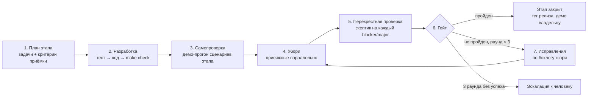

# 12. Цикл разработки «сделали → жюри → доделали → жюри»

> Процесс, по которому идёт вся разработка. Он рассчитан на команду «человек + ИИ-агенты Claude Code», но работает и для обычной команды.

## 1. Цикл одного этапа



Шаги 4–7 автоматизированы двумя сценариями (Claude Code Workflows):

| Сценарий | Файл | Что делает |
|---|---|---|
| `jury-review` | `.claude/workflows/jury-review.js` | Один раунд: присяжные этапа параллельно → скептик на каждое серьёзное замечание → детерминированный гейт → отчёт `jury/reports/<этап>-r<N>.md` + бэклог `jury/backlog/<этап>.md` |
| `jury-loop` | `.claude/workflows/jury-loop.js` | Повторяет `jury-review` → исправления → `jury-review`, пока гейт не пройден, не больше `maxRounds` (по умолчанию 3) |

## 2. Роли

| Роль | Кто | Отвечает за |
|---|---|---|
| Владелец продукта | Вы | Приоритеты, решения при эскалации, согласования с министерством, задачи из `13-owner-tasks.md` |
| Оркестратор | Основная сессия Claude Code | Разбивает этап на задачи, запускает исполнителей и жюри, следит за гейтом |
| Исполнители | Сессии и субагенты Claude Code | Реализация по `CLAUDE.md`: тест → код → `make check` |
| Присяжные | 10 агентов `.claude/agents/jury-*.md` | Независимая оценка по рубрике `jury/RUBRIC.md` |
| Скептик | Субагент в `jury-review` | Опровергает замечания присяжных, отсекает ложные срабатывания |

## 3. Присяжные

| Агент | Взгляд | Главный вопрос |
|---|---|---|
| `jury-ministry` | Заказчик, Минкультуры РБ | Выполнено ли ТЗ, достоверна ли афиша, полезно ли министерству? |
| `jury-contest` | Эксперт конкурса | Чем это лучше 15 других команд? Что запомнится? |
| `jury-ux` | Продуктовый дизайнер | Удобно ли, консистентно ли, доделаны ли все состояния? |
| `jury-architect` | Principal engineer | Можно ли это сопровождать пять лет? |
| `jury-ai` | Руководитель ML | Есть ли хоть одна галлюцинация? Работает ли без LLM? |
| `jury-data` | Инженер качества данных | Нет ли дублей, «призраков» и ошибок часовых поясов? |
| `jury-security` | ИБ и комплаенс | Безопасно ли и законно ли? |
| `jury-a11y` | Эксперт по доступности | Может ли пользоваться каждый, включая слабовидящих и читающих по-башкирски? |
| `jury-mobile` | Руководитель мобильной разработки | Это действительно нативные приложения уровня 4.8+? |
| `jury-personas` | Пять «тайных покупателей» | Сможет ли реальный житель решить свою задачу? |

Состав жюри на каждом этапе задан в `PANELS` внутри `.claude/workflows/jury-review.js` — это единственный источник истины. Краткая справка:

| Этап | Присяжные |
|---|---|
| PREP — готовность к хакатону (12.11) | architect, ux, ai, ministry |
| CP1 — чек-пойнт 1 хакатона | ministry, data, architect |
| CP2 — чек-пойнт 2 | ai, ux, personas, security |
| CP3 — чек-пойнт 3 | contest, ministry, mobile, a11y |
| DEFENSE — перед загрузкой решения (14.11) | contest, ministry, personas, ai |
| M0 Фундамент | architect, ux, ministry |
| M1 Данные | data, architect, security, ministry |
| M2 Веб, поиск, виджет, API | ux, a11y, architect, ministry, personas |
| M3 ИИ-гид, бот, Mini App | ai, ux, security, personas, contest |
| M4 Мобильные приложения | mobile, ux, a11y, personas |
| M5 Вовлечение и министерство | ministry, data, security, ux, personas |
| M6 Укрепление и запуск | security, a11y, architect, mobile, ministry |
| M7 Защита | contest, ministry, personas |
| FINAL | все 10 |

## 4. Шаги раунда и критерии завершения

| Шаг | Готово, когда |
|---|---|
| 1. План этапа | Каждая задача этапа из `11-roadmap.md` разбита на подзадачи, у каждой есть критерий приёмки в формате «Дано / Когда / Тогда» и ссылка на раздел плана |
| 2. Разработка | Для каждой подзадачи: тест, который был красным, стал зелёным; `make check` зелёный; обновлены zod-схемы контракта и `openapi.json`, i18n ru/ba и документация, если они затронуты |
| 3. Самопроверка | Все демо-сценарии этапа пройдены в запущенном продукте, скриншоты сохранены в `jury/reports/artifacts/<этап>/` |
| 4–5. Жюри и проверка | Каждый присяжный вернул оценку; каждое blocker/major прошло скептика |
| 6. Гейт | По правилам из `jury/RUBRIC.md`: каждый ≥ 8, blocker = 0, major ≤ 3 с задачами в бэклоге, `make check` зелёный |
| 7. Исправления | Каждое подтверждённое blocker и major закрыто тестом и исправлением или явно отложено владельцем продукта с причиной |

## 5. Как запускать

В Claude Code в корне репозитория:

```text
# Полный цикл этапа до прохождения гейта
Запусти workflow jury-loop с args {"milestone": "M1", "scope": "Ингест PRO.Культура и 4 источников, дедупликация, статусы, Public API v1"}

# Один раунд жюри
Запусти workflow jury-review с args {"milestone": "M2", "round": 1, "scope": "Сайт, поиск, виджет"}

# Свой состав жюри
Запусти workflow jury-review с args {"milestone": "M3", "jurors": ["jury-ai", "jury-security"], "scope": "Верификатор фактов"}

# Один присяжный вручную
Попроси агента jury-data оценить этап M1
```

Прогресс виден в `/workflows`. Отчёты и бэклоги лежат в `jury/reports/` и `jury/backlog/`.

**Стоимость.** Один раунд — это 3–5 присяжных и по одному скептику на каждое серьёзное замечание, обычно 6–15 агентов. Полный `FINAL` с 10 присяжными — самый дорогой; запускайте его один раз перед защитой и перед релизом.

## 6. Definition of Ready и Definition of Done

**Задача готова к работе (DoR):** есть ссылка на раздел плана; критерии приёмки «Дано / Когда / Тогда»; понятно, какие тесты докажут готовность; внешние зависимости (доступы, ключи, данные) получены или есть мок.

**Задача готова (DoD):**
- тесты на поведение (юнит + интеграционный там, где есть БД, сеть или очередь);
- `make check` зелёный;
- для API: изменение сначала в zod-схемах `packages/contract`, `openapi.json` переэкспортирован, клиенты Swift и Kotlin перегенерированы;
- для UI: только токены и компоненты дизайн-системы, ru и ba строки, все состояния (загрузка, пусто, ошибка, офлайн), снапшот-тесты light/dark;
- для ИИ: eval-наборы зелёные, новые кейсы добавлены;
- для данных: миграция обратима, provenance заполняется;
- документация обновлена (план, ADR при отклонении, README модуля).

## 7. Стратегия тестирования

| Уровень | Инструменты | Что покрывает | Где запускается |
|---|---|---|---|
| Статика | Biome (линт и формат), `tsc --noEmit` (strict), dependency-cruiser, SwiftLint, detekt/ktlint | Стиль, типы, границы модулей | Каждый коммит |
| Юнит | vitest, Swift Testing, JUnit5 | Парсер дат, слоты, скоринг, машина статусов, дедуп-скоринг, верификатор | Каждый PR |
| Интеграция | vitest + реальные PostgreSQL (PostGIS, pgvector, pg_trgm) и Valkey из docker-compose, база `afisha_test` | Репозитории, поиск, ингест, очередь pg-boss, outbox | Каждый PR |
| Контракт | `openapi.json` без дрейфа относительно zod-схем `packages/contract`; schemathesis (в docker) против запущенного API; генерация клиентов Swift/Kotlin без диффа | Совпадение API и спецификации | Каждый PR |
| E2E веб | Playwright (Chromium + WebKit, 390×844 и 1440×900) | Ключевые сценарии, виджет на тестовой странице с чужой CMS | Каждый PR в `web`/`widget` |
| E2E бот | Симулятор апдейтов Telegram + записанные ответы GigaChat | Диалоги из `eval/e2e_dialogs.yaml` | Каждый PR в `channels`/`assistant` |
| Мобильные | XCUITest, Compose UI Test, Maestro, снапшоты | Ключевые сценарии и экраны | Каждый PR в `ios`/`android` |
| Доступность | axe-core, Lighthouse CI, Accessibility Audit (iOS), семантические тесты Compose | WCAG 2.2 AA | Каждый PR в UI |
| ИИ-eval | `/eval` раннер | Пороги из `05-ai-agent.md` §9 | PR в `assistant` + ночью |
| Нагрузка | k6 | SLO из `04-architecture.md` §10 | Перед релизами M2, M3, M6 |
| Безопасность | gitleaks, semgrep, `pnpm audit`, trivy, OWASP ZAP baseline | Секреты, уязвимости, зависимости | Каждый PR + ночью |

`make check` — одна команда, которая локально запускает статику, юнит, интеграцию, контракт и быстрые e2e. В CI идёт полный набор.

## 8. Ветки, коммиты, релизы

- Trunk-based: короткие ветки `feat/<этап>-<кратко>`, PR в `main`, squash-merge.
- Conventional Commits (`feat(search): …`, `fix(dedup): …`) → автоматический CHANGELOG.
- Тег на закрытии этапа: `m1.0`, `m2.0`… Релиз в прод — с M6 (`v1.0.0`) по SemVer.
- Каждый PR: эфемерный стенд с превью-ссылкой (web/admin/widget) и тестовым ботом.

## 9. Метрики процесса

Ведутся в `jury/README.md` после каждого этапа: раундов до гейта, доля замечаний, отклонённых скептиком (больше 30 % — присяжный «шумит», надо уточнить его роль), доля blocker, найденных жюри, а не тестами (больше 0 — повод добавить тест на этот класс ошибок), средний балл по присяжным.
